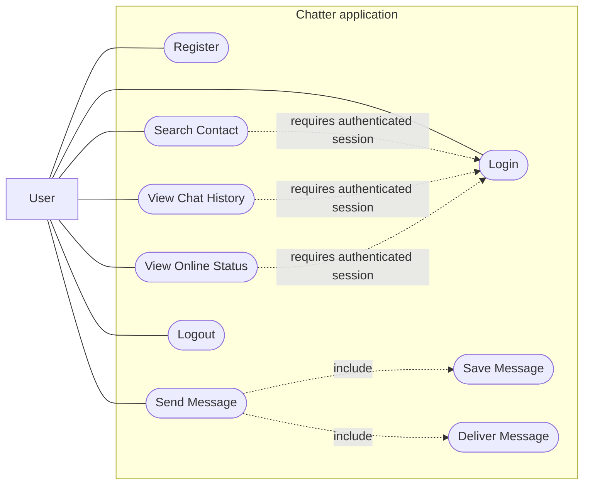
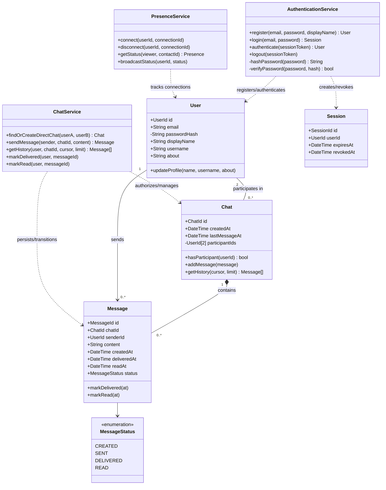
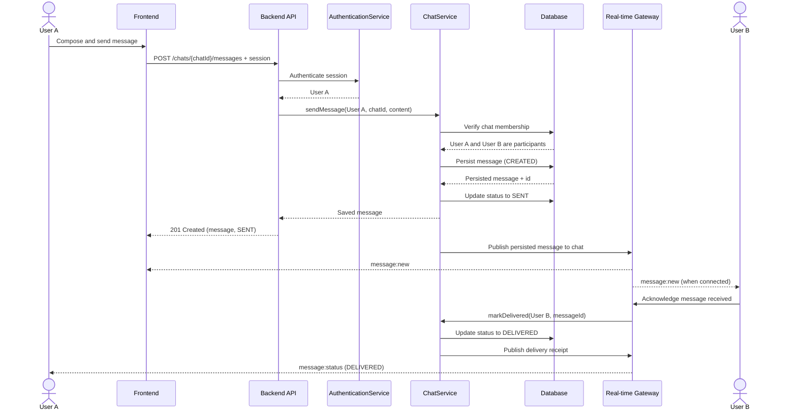
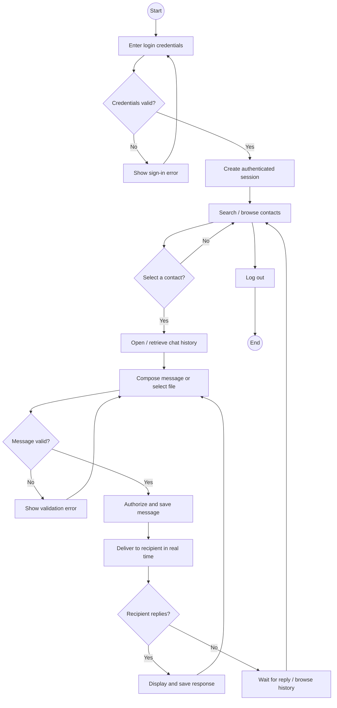
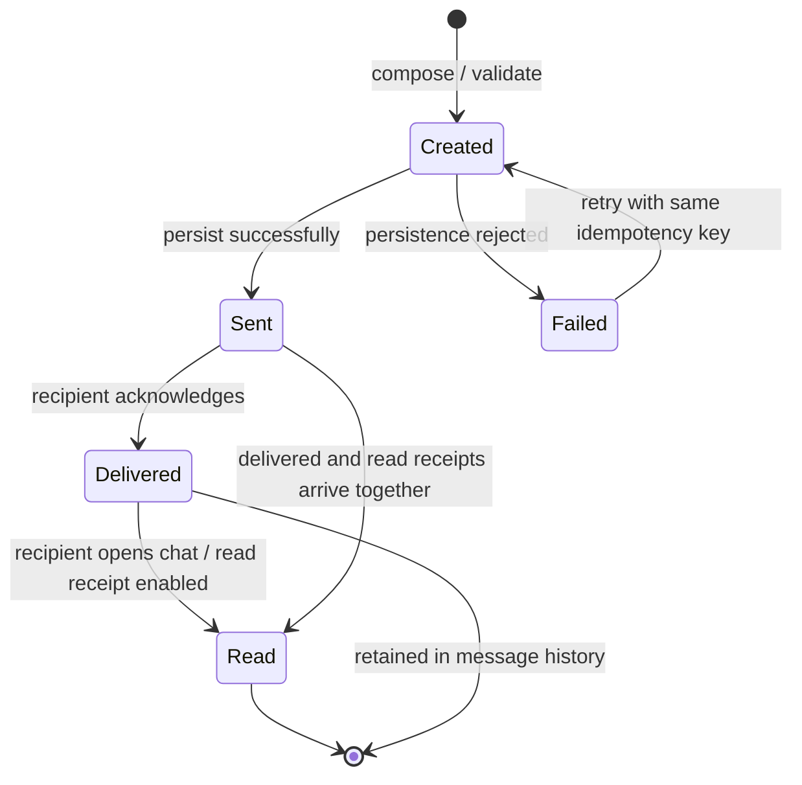
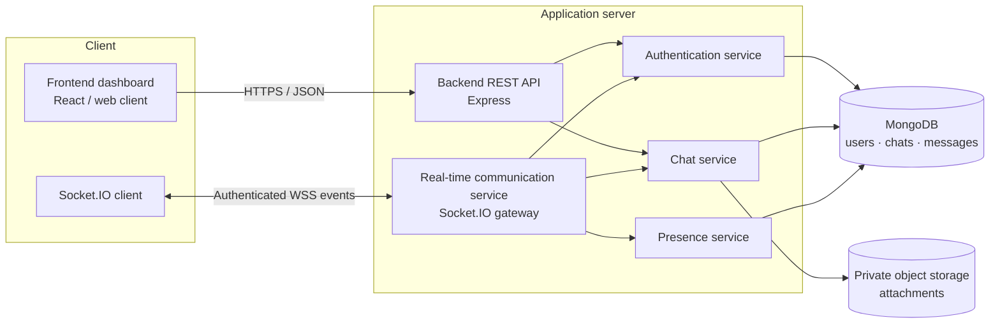
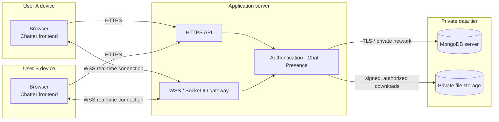

# Chatter — Real-Time Chat Application

A responsive, WhatsApp-inspired chat dashboard and college OOAD project. Open `index.html` in a modern browser to explore the interactive front-end demo.

> **Project/demo website:** the runnable website is [`index.html`](./index.html). This static demo runs on your device; it is not a publicly hosted website and does not connect users across devices. A production launch requires hosting and the backend described below.

## Problem statement

People need a convenient way to communicate privately, find one another, exchange files, and keep a history of their conversations. Chatter models these everyday interactions in a friendly chat dashboard while providing an object-oriented design for a secure, real-time production system.

## Objectives

- Let a person find a contact and exchange one-to-one messages.
- Show online presence, message times, and sent, delivered, and read indicators.
- Keep conversations, profile preferences, and shared files easy to find.
- Provide a responsive, accessible, and understandable college-project demonstration.
- Describe a modular, secure architecture that can be developed into a multi-user real-time service.

## Scope

### Included in this runnable demo

The dashboard includes sample accounts and conversations, conversation search, All/Unread/Favorites filters, one-to-one chat history, a simulated reply for an online contact, message status indicators, contact selection, local profile settings, notification/read-receipt preferences, persistent light/dark themes, profile-level block/unblock controls, file attachments, shared-file browsing, and a mobile layout. Profile and text-message data are stored in this browser's `localStorage`.

### Not provided by this static demo

There is no live account registration or password verification, network connection, cross-device presence, real-time delivery between two people, MongoDB service, end-to-end encryption, or server-side file storage. The “private conversation” copy is a UI label, not a claim that the demo implements encryption. Use the architecture, algorithms, and integration notes in this document to build the production service; never treat client-side storage or simulated login as secure authentication.

## Requirements

### Functional

1. Register an account and securely log in.
2. View and edit profile information and preferences.
3. Search for contacts and start a one-to-one conversation.
4. Send and receive text messages in real time.
5. Show online/offline presence and last-seen time.
6. Store message sender, conversation, content, timestamp, and delivery status.
7. Retrieve conversation history and shared files.
8. Log out, expire sessions, and protect authenticated routes.
9. Attach and download files with size/type validation.
10. Personalize the interface with a persistent light or dark theme and block/unblock contacts.

### Non-functional

- **Security:** TLS; password hashing using Argon2id or bcrypt; expiring, revocable sessions; server-side authorization on every conversation operation; input validation; rate limits; safe file handling; no passwords or session tokens in client-side persistent storage.
- **Privacy:** only conversation participants can retrieve its messages or files; user presence and read receipts follow account settings.
- **Performance:** paginate message history; use indexed conversation/time queries; deliver active messages over WebSocket; avoid blocking the UI while uploading.
- **Reliability:** persist a message before acknowledging it; use unique message IDs and idempotent delivery; reconnect with backoff and recover missed messages.
- **Usability/accessibility:** responsive layouts; keyboard-friendly navigation; labelled controls; visible timestamps/status; helpful validation and error states.
- **Maintainability:** cohesive services, explicit interfaces, typed validated request/response models, automated tests, and structured logs without sensitive message content.

## OOAD and system architecture

The application is organized around four responsibilities:

1. **Frontend:** web client for account/profile forms, the dashboard, chat history, and uploads. The included static demo is `index.html`, `styles.css`, and `app.js`.
2. **Backend/API:** validates requests, applies authorization, manages account/profile/history, and delegates domain operations to services.
3. **Real-time gateway:** authenticated WebSocket (Socket.IO) connection for presence, new messages, delivery/read receipts, and reconnect recovery.
4. **Persistence:** MongoDB stores users, conversations, messages, and attachment metadata; files live in private object storage and are served only after authorization.

### Proposed production stack

React, Node.js, Express, Socket.IO, MongoDB/Mongoose, and private object storage. The demo has no install/build step. A production backend is a separate deployment: this project does **not** pretend that a static page is a deployed, secure multi-user service.

### Domain model

- **User:** account identity, private credential hash, profile, and session state.
- **Chat:** a one-to-one conversation; contains two distinct participants and references its messages.
- **Message:** immutable sender, chat, content/attachment metadata, timestamp, and lifecycle status.
- **AuthenticationService:** registration, password verification, session issuance/revocation, and authentication.
- **ChatService:** authorization, persistence, history retrieval, and state transitions for messages.
- **PresenceService:** online connections and last-seen updates, scoped to authorized contacts.

Prefer composition for the domain entities. No artificial inheritance hierarchy is needed for these six core classes. If the product later supports group chats, introduce a `Conversation` abstraction with `DirectChat` and `GroupChat` specializations only when their behavior actually differs.

### Proposed persistence schema

- `users`: `_id`, `email` (unique index), `passwordHash`, `displayName`, `username` (unique index), `about`, `createdAt`, `updatedAt`.
- `conversations`: `_id`, `type`, `participantIds` (index), `createdAt`, `lastMessageAt`; enforce exactly two distinct members for a one-to-one conversation.
- `messages`: `_id`, `conversationId` + `createdAt` (compound index), `senderId`, `text`, optional attachment metadata, `createdAt`, `deliveredAt`, `readAt`; validate sender membership on write and read.
- `sessions`: hashed opaque session token, `userId`, expiry, revocation time, and relevant device metadata; set a TTL index on expiry.
- `attachments`: opaque storage key, original display name, safe MIME type, size, uploader ID, conversation ID, and upload timestamp. Store file bytes outside MongoDB; require participant authorization to download.

## UML diagrams

The seven Mermaid diagrams below are deliberately consistent: a person is the external `User` actor; the domain `User` class represents their account; `Chat` owns message history; services delegate to MongoDB; the real-time gateway delivers persisted messages and status updates.

### 1. Use Case Diagram

**In simple English:** A person registers or signs in, then can find contacts, exchange messages, browse chat history and presence, and log out. Sending a message includes storing it and delivering it to the recipient when they are connected.



### 2. Class Diagram

**In simple English:** Authentication, chat, and presence have separate services. A user participates in conversations; each one-to-one chat has two users and contains messages. The message status moves through a controlled lifecycle.



### 3. Sequence Diagram

**In simple English:** User A sends a message. The backend authenticates A, verifies that A belongs to the chat, persists the message, acknowledges it as sent, and publishes it over the real-time gateway. If B is connected, B receives it and the server records and publishes a delivery receipt.



### 4. Activity Diagram

**In simple English:** The user signs in before looking up a contact. The user selects a conversation, writes and sends a message, then waits for a response or continues chatting. Invalid sign-in returns the user to the login step.



### 5. State Machine Diagram

**In simple English:** A message starts as `CREATED`, becomes `SENT` once saved, and becomes `DELIVERED` when the recipient acknowledges it. A read receipt moves it to `READ`. Statuses do not move backwards.



### 6. Component Diagram

**In simple English:** The frontend uses the backend API for accounts and history, and an authenticated real-time connection for chat and presence events. Backend services verify users and conversations before accessing the database or private file storage.



### 7. Deployment Diagram

**In simple English:** Each device loads the web client over HTTPS and keeps a secure WebSocket connection open for live events. The application server talks privately to the database and file storage; the database itself is not exposed to user devices.



## Module descriptions

| Module | Responsibility |
| --- | --- |
| Authentication & sessions | Validate registration/login; hash passwords; issue, expire, rotate, and revoke sessions. |
| Profile & preferences | Validate profile updates and enforce privacy/notification/read-receipt preferences. |
| Contacts & presence | Search only permitted public fields; track socket connections and last seen. |
| Chat & messages | Create direct conversations; authorize membership; persist and paginate messages. |
| Real-time delivery | Authenticate socket connections; route messages/receipts only to authorized chat participants; recover after reconnect. |
| Attachments | Enforce size and content policy; use opaque object keys and private, authorized download links. |
| Web dashboard | Present search, chat history, composer, status, profile, and shared-file controls. |

## Core algorithms / pseudocode

### Secure login and session creation

```text
register(email, password, displayName):
    validate normalized email, password policy, display name
    if account exists for email: return generic conflict result
    hash = Argon2id(password)
    create User(email, hash, displayName)
    return created account without passwordHash

login(email, password):
    user = find user by normalized email
    if user is absent OR Argon2id.verify(password, user.passwordHash) is false:
        return the same generic authentication error
    rawToken = cryptographicallyRandomBytes()
    store hash(rawToken), userId, expiry in Session
    set rawToken in Secure, HttpOnly, SameSite cookie
    return minimal public user profile
```

### Send, persist, and deliver a message

```text
sendMessage(session, chatId, text, attachment, idempotencyKey):
    sender = authenticate(session)
    validate text length and attachment policy
    chat = load chat(chatId)
    if sender.id is not in chat.participantIds: deny without revealing chat
    if idempotencyKey already has a persisted result: return that result
    message = persist(chatId, sender.id, validated content, status=CREATED)
    persist transition CREATED -> SENT
    acknowledge sender with message id and SENT
    publish only to chat participants over authenticated real-time gateway
    on recipient acknowledgement:
        verify recipient is the other chat participant
        transition SENT -> DELIVERED and notify sender
    on authorized read event with read receipts enabled:
        transition DELIVERED -> READ and notify sender
```

### Retrieve history safely

```text
getHistory(session, chatId, before, pageSize):
    viewer = authenticate(session)
    pageSize = clamp(pageSize, 1, 100)
    chat = load chat(chatId)
    if viewer.id is not a participant: deny
    return messages in chat where createdAt < before
           sorted by createdAt descending, limited to pageSize
           with only client-safe fields
```

### Demo behavior

`app.js` persists demo conversations and preferences locally. Sending a message appends it to the selected chat, updates the sidebar, and simulates a `SENT` → `DELIVERED` acknowledgment. When the demo contact is online, a delayed sample response illustrates an incoming message. These are local simulations, not a network transport or account system.

## Implementation files

- [`index.html`](./index.html) — semantic, accessible dashboard structure and icon library.
- [`styles.css`](./styles.css) — responsive desktop/mobile styling and interactive states.
- [`app.js`](./app.js) — sample data, contact/search/filter behavior, local message history, simulated acknowledgments, profile settings, and file sharing.

### Run locally

1. Download or clone the project files.
2. Open `index.html` in a modern browser, or serve this directory with any static web server.
3. Try searching **Sophie**, switching the **Unread** filter, starting a chat with another contact, sending a message, editing your profile, changing the theme in Settings, blocking a contact from their profile, and attaching a file.

No website URL has been deployed. To create a shareable public website link, deploy this frontend to a static host (for example GitHub Pages or Netlify); deploying real multi-user chat additionally requires the production API, real-time service, database, private file storage, and HTTPS/WSS described above.

## Testing plan and sample test cases

Run the manual checks in a current desktop and mobile browser. Verify persistence by refreshing after profile/message changes. For production, automate unit tests for services and state transitions, API authorization/integration tests against a test database, WebSocket delivery tests with two clients, upload-policy tests, and browser-level accessibility/responsive smoke tests.

| ID | Test | Expected result |
| --- | --- | --- |
| T01 | Open `index.html` | Dashboard loads with sample chats and an active Sophie conversation. |
| T02 | Search for `Marcus` | Matching conversation remains; unrelated chats are hidden. |
| T03 | Choose **Unread** | Only conversations with unread messages are displayed. |
| T04 | Select an unread conversation | It opens and its unread badge clears. |
| T05 | Send whitespace-only text | No blank message is added. |
| T06 | Send text using Enter | Message appears; status changes from sent to delivered; an online demo contact may reply. |
| T07 | Use Shift+Enter | A newline is inserted without sending the message. |
| T08 | Select a contact with **New chat** | Its conversation is opened or created. |
| T09 | Update profile and refresh | Profile name/about remain saved in the same browser. |
| T10 | Attach a small file | A file card appears in the conversation and shared-files panel. |
| T11 | Attach a file larger than 10 MB | The demo rejects it with a visible explanation. |
| T12 | Resize to a phone viewport | Conversation list and active chat remain usable; Back returns to the list. |
| T13 | Production-only: request another user's chat history | Server rejects unauthorized access without returning message contents. |
| T14 | Production-only: recipient acknowledges a persisted message | Message transitions to `DELIVERED` once; sender receives one status event. |
| T15 | Production-only: expired/revoked session opens a socket | Connection is rejected and protected history is unavailable. |
| T16 | Choose Dark under Settings → Appearance, then refresh | Dark theme remains active in the same browser. |
| T17 | Block a contact from their profile and try sending a message or file | Confirmation is required; chat shows a blocked banner and sending/sharing controls are hidden. |
| T18 | Unblock the contact from the profile or Settings → Blocked contacts | The conversation controls return and the contact is removed from the blocked list. |

## Expected output

- The home view shows pinned and recent conversations, search and filters, the selected message history, and profile/shared-file details.
- A sent message appears on the right with its timestamp and changing delivery indicator.
- A new contact can be selected without leaving the dashboard; on small screens, Back returns to the conversation list.
- Profile changes, preferences, and supported demo data persist in the current browser.
- A selected file appears as a downloadable attachment card in this browser demo.

## Conclusion

Chatter demonstrates the core user-facing flow and the object-oriented model for a WhatsApp-inspired messaging product. Its services, entities, UML diagrams, and deployment plan define the production direction, while the supplied static website is an honest, immediately runnable and shareable-as-files prototype rather than a falsely advertised secure online messenger.

## Future enhancements

- Implement the documented authentication, REST API, WebSocket gateway, database, and deployment.
- Add group conversations, typing/read receipts over sockets, offline delivery queues, reconnect synchronization, and push notifications.
- Implement encrypted transport and carefully designed end-to-end encryption with audited key management.
- Add secure image/document preview, virus scanning, storage quotas, and expiring download links.
- Add audio/video calling, accessibility audits, internationalization, automated tests, and observability.
- Deploy the frontend and backend to production hosts and replace demo copy with verified, implemented security guarantees.
